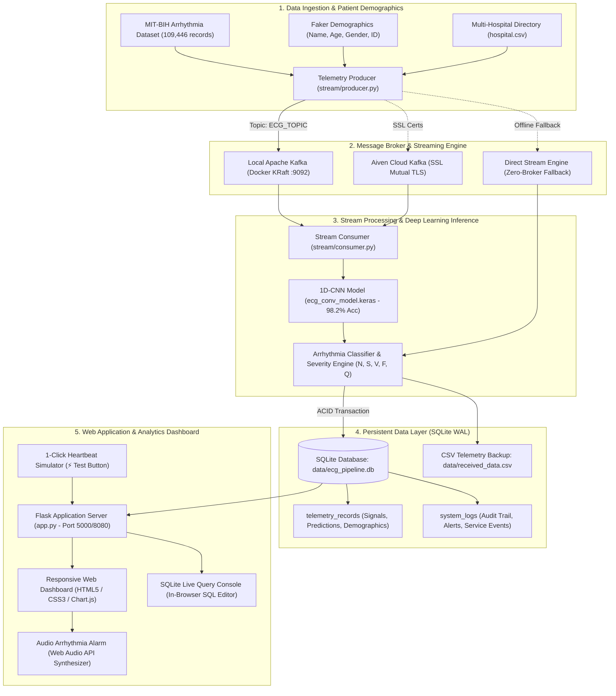
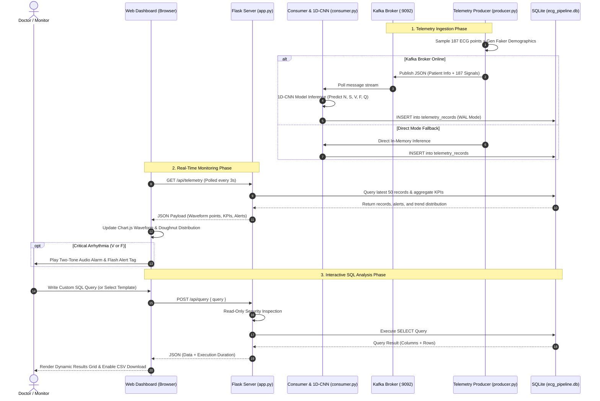
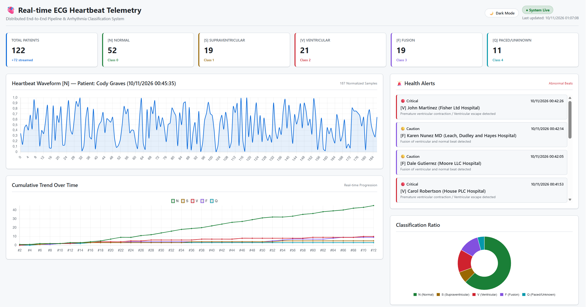
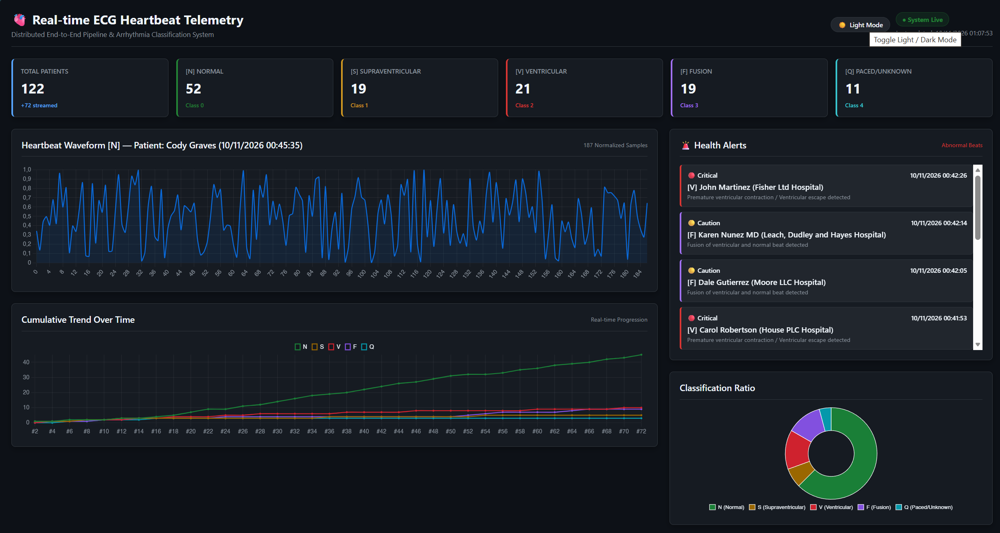
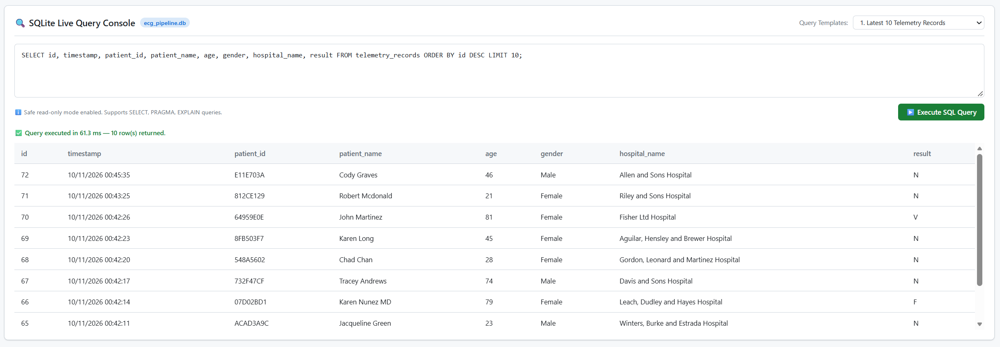

# Real-time ECG Heartbeat Classification Pipeline

An end-to-end distributed data engineering and deep learning system designed to ingest, process, and classify real-time electrocardiogram (ECG) heartbeat signals for early arrhythmia detection.

---

## 🏗️ System Architecture & Workflow



The platform simulates a multi-source global telemetry setup and processes streaming medical data through a robust pipeline:

1. **Global Data Ingestion & Streaming (`Apache Kafka` & `Aiven Cloud`):**
   - Simulated multi-hospital data sources transmitting continuous ECG records through an **Apache Kafka** cluster hosted on **Aiven Cloud** (Hong Kong server) acting as a centralized broker.
   - Leveraged Python's `Faker` library to synchronously generate patient demographic metadata alongside telemetry streams.
2. **Distributed Preprocessing & Transformation (`Spark SQL` & `PySpark`):**
   - Processed the benchmark **MIT-BIH Arrhythmia Dataset** (`109,446 samples` across 5 AAMI standard classes).
   - Applied **Spark SQL** for sliding windowing (10s intervals), signal amplitude normalization ($[0, 1]$), R-peak extraction, 188-length zero-padding, and **Over-Resampling** to resolve severe class imbalance (e.g., normal class $N$ at 82.8% vs. fusion class $F$ at 0.7%).
3. **Distributed Model Training (`TensorFlow` & Deep Learning):**
   - Trained and evaluated 5 neural network architectures (**1D-CNN, GRU, LSTM, RNN, MLP**) across distributed hardware (`2x GPUs` and `8x TPUs`).
   - Selected the top-performing **1D-CNN model** to execute real-time classification.
4. **Interactive Monitoring Dashboard (`Flask`, `HTML5/CSS3`, `Chart.js` & `Streamlit`):**
   - Deployed a responsive web dashboard featuring live ECG waveform visualization, real-time health alerts, Dark/Light theme switching, audio arrhythmia chime, and an embedded **SQLite Live Query Console** for in-browser data analytics.

### 🔄 End-to-End Real-Time Data Flow



---

## 📸 Dashboard Screenshots

| Light Mode Dashboard | Dark Mode Dashboard |
| :---: | :---: |
|  |  |

### 🔍 SQLite Live Query Console


---

## 📊 Dataset Overview

- **Source Collection:** MIT-BIH Arrhythmia Database via PhysioNet (`109,446 records`).
- **Target Classes (AAMI EC57 Standard):**
  - **N:** Normal / Bundle branch block / Escapes
  - **S:** Atrial premature / Supraventricular premature
  - **V:** Premature ventricular contraction / Ventricular escape
  - **F:** Fusion of ventricular and normal
  - **Q:** Paced / Unclassifiable

---

## 🤖 Model Performance Evaluation

Evaluated across macro-averaged metrics to handle class distribution challenges:

| Model Architecture    |  Accuracy  | Precision  |   Recall   |  F1-Score  |
| :-------------------- | :--------: | :--------: | :--------: | :--------: |
| **1D-CNN (Selected)** | **98.20%** | **91.99%** | **90.80%** | **91.38%** |
| **GRU**               |   95.63%   | **93.44%** |   77.44%   |   83.17%   |
| **LSTM**              |   83.86%   |   86.99%   |   60.47%   |   64.97%   |
| **MLP**               |   94.71%   |   90.72%   |   74.79%   |   80.58%   |
| **RNN**               |   23.40%   |   55.75%   |   31.36%   |   22.91%   |

---

## 🛠️ Tech Stack

- **Big Data & Streaming:** Apache Kafka (Local KRaft / Aiven Cloud SSL), Apache Spark, Spark SQL
- **Database & Storage:** SQLite (ACID, WAL mode, auto-indexed), CSV Exports
- **Deep Learning & ML:** TensorFlow, Keras (1D-CNN, GRU, LSTM, RNN, MLP)
- **Frontend & Visualization:** Responsive HTML5 / CSS3 / JavaScript (Chart.js, Flask REST API), Streamlit
- **Infrastructure / Compute:** Kaggle GPUs, Google Colab TPUs, Docker, Docker Compose

---

## 🚀 Quick Start Guide

### 1. Installation

Clone repository and install dependencies:
```bash
pip install -r requirements.txt
```

### 2. Running Unit Tests

Run the full automated test suite covering configuration, Faker metadata, alerting rules, and SQLite query safety:
```bash
python -m unittest discover -s tests -v
```

### 3. Launching Real-time Web Dashboard

#### Option A: Responsive HTML5/CSS3 Web Dashboard (Recommended)
Run the Flask web server:
```bash
cd source_code
python app.py
```
Open your browser at **`http://127.0.0.1:5000`**. Features include:
- **Light & Dark Mode:** Instant 1-click toggle with preference saved in `localStorage`.
- **Live ECG Waveform:** 187 normalized sample points plotted via Chart.js.
- **Health Alert System:** Automatic detection and classification of abnormal beats (`S`, `V`, `F`, `Q`).
- **One-Click Simulator Button:** `⚡ Send Sample Heartbeat` button on the UI to test telemetry and 1D-CNN classification instantly.
- **Embedded SQL Live Query Console:** Query `ecg_pipeline.db` directly in your browser with pre-built query templates.
- **CSV Export:** Download full telemetry records anytime.

#### Option B: Streamlit Dashboard
```bash
cd source_code
streamlit run stream/streamlit_app.py
```

### 4. Running the Streaming Pipeline (Producer & Consumer)

#### Option A: Direct Simulation Mode (Zero Setup - No Kafka needed)
If Kafka is not running, `producer.py` autobmatically detects it and switches to **Direct Stream Simulation Mode**:
```bash
cd source_code
python stream/producer.py
```

#### Option B: Using Local Kafka (Docker)
Start a lightweight local Kafka broker (KRaft mode, no Zookeeper required):
```bash
docker run -d --name kafka-local -p 9092:9092 bashj79/kafka-kraft:latest
```

Then start the consumer and producer:
```bash
# Terminal 1: Consumer (listens to Kafka, classifies with 1D-CNN, writes to SQLite & CSV)
cd source_code
python stream/consumer.py

# Terminal 2: Producer (generates Faker patient metadata & streams ECG signals)
cd source_code
python stream/producer.py
```

#### Option C: Using Aiven Cloud Kafka (SSL Authenticated)
To switch to Aiven Cloud, place your `ca.pem`, `service.cert`, and `service.key` into `source_code/stream/key/` and run:
```bash
$env:USE_LOCAL_KAFKA="false"    # Windows PowerShell
export USE_LOCAL_KAFKA=false     # Linux / MacOS
```

### 5. Running with Docker Compose

Deploy the entire end-to-end pipeline (Local Kafka + Producer + Consumer + Web Dashboard):
```bash
docker compose up --build
```

